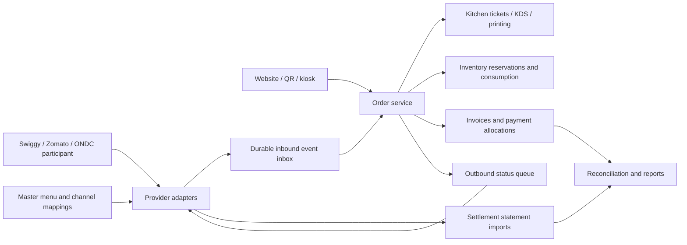

# Restaurant Billing System: Product and Engineering Foundation

**Research date:** 8 October 2026  
**Primary source:** [Petpooja POSS blog archive](https://blog.petpooja.com/core-product/poss/)  
**Coverage:** All 685 published posts in the supplied category, plus the rest of the blog: 832 public posts in total. All article bodies were extracted and screened. The recommendations below use a curated subset read in context; the full source catalogue and local snapshots are in `petpooja-research`.

**Additional resources:** 527 public glossary, template-preview, tool, and site pages were captured. One additional site page (`/usa`) could not be retrieved because it redirects in a loop. Gated spreadsheet/PDF downloads were not requested. The extraction covers 1,359 unique content URLs; navigation and archive indexes are inventoried separately.

**Purpose:** Explain what to build, how the important workflows should work, why each capability matters, and how to connect online ordering to a dependable billing system.

**Working product assumption:** An India-focused product for an independent restaurant, cafe, or QSR, with dine-in, takeaway, and delivery. Design the records to support additional outlets later. Country-specific tax and invoice rules belong in configurable profiles.

**Evidence convention:** Linked source IDs support restaurant needs and published product behavior. “Recommended implementation” means an engineering proposal derived from those needs, not a description of Petpooja's internal code. This blog does not provide Swiggy/Zomato API contracts or independently validated performance benchmarks. Legal rules, provider contracts, and tax classifications must be verified against their current primary sources before release.

## 1. The central product decision

A strong restaurant billing system connects **orders, the kitchen, money, and stock**. The receipt is one output of that system.

A waiter may add three rounds of items to one table. The kitchen receives several tickets. Four guests may need separate invoices, with each paying through a different method. A payment provider may deposit the money the next day after deducting fees. Those are distinct events and need distinct records.

Petpooja's feature overview groups its product into billing, KOTs, menu management, inventory, online orders, CRM, reporting, an aggregator centre, and a dashboard. These are useful domain boundaries, rather than a target number of screens or features. [S198]

The first release should prove five outcomes:

1. Every accepted order reaches the correct kitchen station once as a logical instruction.
2. Every final bill explains its items, discounts, taxes, rounding, and payments.
3. The restaurant can account for its cash and outstanding electronic settlements.
4. Staff can recover from internet, printer, and device interruptions.
5. Changes that affect revenue remain attributable to a person and a reason.

Online ordering and recipe inventory become much easier when those foundations already work. [S068] [S076] [S088] [S089] [S230]

## 2. Choose workflows by restaurant format

| Format | Workflows that decide product fit | Why they matter |
|---|---|---|
| Full-service restaurant | Running tables, table moves and merges, course firing, split bills, captain ordering | A meal evolves over time; the order must follow guests and their courses. |
| QSR / takeaway | Fast item entry, pay-first orders, token display, pickup status | Counter speed and clear pickup handling prevent queues. |
| Cafe | Sizes, milk choices, extras, repeat customers, recipe consumption | Customisation changes both price and ingredient use. |
| Cloud kitchen | Channel and brand identification, unified order inbox, packaging, rider handover, settlement reports | Several storefronts can share one kitchen while remaining financially distinguishable. |
| Pizzeria | Size/crust variations, toppings, slices, combos | A configurable product must price and consume stock correctly without creating hundreds of menu items. |
| Bakery | Weighted items, scheduled orders, batch production, expiry | Sales units and preparation timing differ from a plate-based restaurant. |
| Bar / brewery | Running tabs, measures, bottle-to-peg conversion, separate food/liquor tax treatment | Ingredient units, leakage, and tax regimes need dedicated handling. |
| Food court / canteen | Concurrent counters, counter-specific stock, prepaid balances, credit accounts | One diner balance may be used across multiple counters. |
| Chain / central kitchen | Outlet overrides, menu publication tracking, indents, dispatch/receipt, consolidated reports | Head office needs consistency without losing local accountability. |

Sources: [S094] [S092] [S101] [S102] [S147] [S156] [S171] [S072] [S073]

**Recommended starting scope:** One outlet; dine-in and takeaway; station-routed KOTs; regular tax invoices and non-tax collection modes; cash, card, and UPI recording; staff rights; day close; offline operation; export. Add one real online channel after the local workflow is stable. A cloud-kitchen-first product should bring the online inbox into the initial release.

## 3. Important features, advantages, and how to build them

| Capability | Restaurant problem it solves | Recommended implementation | Advantage / measure |
|---|---|---|---|
| Fast billing | Staff search or calculate during a rush | Category grid, item search, short codes, keyboard flow, common modifiers, saved running orders | Measure order-entry time and correction rate on real menus. |
| Variations and add-ons | Extras are mispriced or omitted from KOTs | Priced variations and modifier groups with selection rules and ingredient links | Higher accuracy; transparent extras; better item-level sales analysis. |
| Station-wise KOTs | Tickets go to the wrong kitchen section | Item-to-station mapping; ticket revisions; explicit additions and cancellations | Less relay work and fewer remakes. |
| Tableside ordering | Waiters queue at one cashier terminal | Shared running order with named captain, table session, and revision control | Fewer counter trips and clearer instructions. |
| Split invoices and mixed tenders | Group settlement duplicates or loses items | Invoice allocations reference the original order lines; payment allocations are separate | Guests can pay flexibly without double stock deduction. |
| Online order inbox | Staff monitor several aggregator tablets | Provider adapters feed one normalized order service | Less manual entry; one queue and one kitchen flow. |
| Menu and availability sync | Sold-out dishes or old prices remain online | One master catalogue, channel overlays, publication status, retry queue | Fewer cancellations and less menu maintenance. |
| Recipe inventory | Purchases are recorded but actual usage is unclear | Versioned recipes, units, reservation/consumption movements, physical counts | Exposes portion variance, waste, and ingredient shortages. |
| Daily reconciliation | Sales are confused with bank deposits | Separate tender collection, cash movement, fees, refunds, and settlements | Variances become explainable the same day. |
| Staff rights and audit history | Cash sales disappear through edits or voids | Named users; permission checks; manager approval for risky actions; durable history | Accountability without slowing ordinary billing. |
| Offline local operation | Connectivity failure stops service | Durable local storage and LAN operations; cloud sync with replay protection | Continued local orders, printing, and cash collection. |
| Reports and exports | Owner sees volume but cannot explain profit | Define report semantics; item/channel/tax/tender views; CSV export | Better pricing, purchasing, staffing, and accountant handoff. |

Sources: [S188] [S233] [S112] [S070] [S080] [S081] [S414] [S076] [S088] [S089] [S068] [S550]

### 3.1 Menu management: build the master before building the biller

**What matters:** A dish can have sizes, extras, notes, a recipe, tax treatment, a kitchen station, and different availability across outlets or channels. Petpooja's menu articles explicitly describe categories, variations, add-ons, recipes, tax mapping, short codes, time menus, combos, and BOGO. [S082] [S233] [S101]

**How to implement it:**

1. Create an immutable internal item ID. Keep names and short codes editable.
2. Separate the parent item from its priced variations, such as regular and large.
3. Create modifier groups, such as milk type or toppings. Give each group minimum/maximum selections, permitted duplicates, price rules, and station/recipe implications.
4. Store preparation notes separately from priced choices. “No onion” should not accidentally become a charge.
5. Add an outlet/channel price layer. A common catalogue does not require identical dine-in and delivery prices.
6. Map recipes, tax profiles, preparation stations, dietary attributes, and applicable calorie/allergen information.
7. Version changes and publish them deliberately. Save the version used on each accepted order.

**Example:** A large pizza at ₹450 with an extra-cheese choice at ₹50 has a ₹500 item value before applicable tax or discount. The KOT must show the size and extra cheese; inventory must include the extra cheese; reports should retain both the base item and the modifier.

**Why this helps:** One structured menu powers the cashier, captain device, online store, kitchen, inventory, and reports. A copied list of names and prices cannot reliably do that.

**Important rules:** Disabling an item preserves its history. A combo needs a sellable parent plus fulfilment components. BOGO can create a zero-price fulfilment component that still consumes ingredients. Price and discount allocation across components must preserve the total and each applicable tax treatment.

### 3.2 Billing: make every amount explainable

**Recommended calculation sequence:**

```text
Priced lines = quantities × selected variation prices + priced extras
Eligible discounts = item discounts + allocated order discounts
Taxable bases = classified line values after permitted discounts
Taxes = tax components calculated from those bases
Invoice total = discounted line values + taxes + permitted charges + round-off
Outstanding = invoice total − successful allocated payments − approved credit settlements
```

This is a conceptual sequence. Inclusive pricing, mixed tax treatment, exempt supplies, discount timing, and credit notes require explicit rules. Do not apply one arithmetic formula to every sale.

Use decimal arithmetic or integer minor units for money. Record rounding adjustments explicitly. Store both the calculation inputs and the resulting components so a printed bill and an exported report agree months later.

**Discounts:** Support amount/percentage, line/order scope, eligible categories, validity period, maximum benefit, permitted users, and stacking rules. For online orders, also record who funds the offer: restaurant, platform, or shared. Allocate an order-level discount once; splitting a bill must not increase its total value. The split-bill article's warning about discounts should be implemented as an allocation invariant, not as a rule that applying the same percentage to disjoint items necessarily duplicates a discount. [S216] [S070]

**Invoice fields to model:**

| Group | Fields |
|---|---|
| Issuer | Legal/trading name, outlet address, applicable registration details, GSTIN when relevant, FSSAI number |
| Document | Document type, immutable ID, invoice number/series, date, financial year, business day |
| Context | Order reference, order type/channel, table/token, cashier, outlet |
| Buyer | Name/address/GSTIN when required, B2B/B2C classification; contact details only as necessary |
| Lines | Description, quantity, unit, variation/extras, unit price, discount, classification/HSN/SAC as applicable, taxable value |
| Tax and total | Component rates/amounts, applicable charges, round-off, total; optional tips recorded separately |
| Collection | Tender amounts, payment reference/status, credit amount, remaining balance |

The restaurant bill template distinguishes regular tax invoices from composition bills of supply and includes FSSAI and serial-number fields. Treat its previews as research inputs; verify current mandatory particulars and electronic-document exemptions before finalizing the template. [T073] [S074]

**Worked example, assumptions stated:** Two items at ₹250 each, a 10% eligible discount, tax-exclusive pricing, and an applicable combined GST rate of 5%:

```text
Item value                         ₹500.00
Discount                            ₹50.00
Taxable value                      ₹450.00
CGST at 2.5%                        ₹11.25
SGST at 2.5%                        ₹11.25
Invoice total before round-off     ₹472.50
```

If configured rupee rounding makes the payable total ₹473.00, store ₹0.50 as round-off. An optional tip does not silently change the food value. Its legal/accounting treatment requires a defined collection policy.

### 3.3 Tables, split bills, and mixed payments

Maintain a **table session** that can span several physical tables. Orders belong to that session; tables are seating assignments. Moving a party changes the assignment, not the historical invoice number.

**How to split correctly:**

1. Keep a complete running order while the table continues ordering.
2. Allocate items or shares to invoice drafts when guests request settlement.
3. Preserve fractional shared-item allocations and distribute any rounding remainder deterministically.
4. Validate that all allocations sum to the original quantities and amounts.
5. Issue each final invoice with its own document identity.
6. Allocate cash/card/UPI payments to those invoices independently.
7. Do not create a second kitchen instruction or ingredient-consumption event merely because an invoice was split.

Distinguish **split invoices** from **one invoice paid by several tenders**. Both are useful, but only the first creates multiple tax documents. Restrict merge/move operations involving already finalized invoices, and provide an explicit correction workflow. [S070] [S094]

**Advantage:** Guests pay as they wish; kitchen and stock remain coherent; the cashier can explain any outstanding amount.

### 3.4 KOT and kitchen display management

A kitchen order ticket communicates preparation; an invoice communicates a sale. They need different status and revision handling. Petpooja's KDS articles describe one queue for dine-in and online orders, station views, preparation steps, food-ready status, and advance-order labels. [S087] [S086] [S085]

**Recommended workflow:**

1. Staff or the online-order service confirms an order.
2. The system routes each line to its mapped kitchen station.
3. It creates logical tickets carrying order/table/token, channel/brand, items, quantities, modifiers, notes, and required preparation time.
4. A later addition creates a new delta ticket. A reduction produces a cancellation instruction with a reason and preparation state.
5. The KDS records started, ready, and handed-over states. Course holds and future orders remain visible without being fired early.
6. An order becomes food-ready only when the required fulfilment components are ready.

**Printing:** Use a durable print-job queue with station, ticket ID/revision, attempt number, status, and last error. A failed printer should leave the ticket recoverable. Reprinting must not add another sale or deduct stock again.

Physical printing cannot always prove whether a page printed immediately before a disconnect. Expose that uncertainty to staff and label reprints clearly; promise one logical ticket identity rather than impossible exactly-once paper delivery.

**Advantage:** Fewer lost instructions, consistent preparation notes, measurable station delays, and reliable recovery from paper/printer problems.

### 3.5 Roles, approvals, and revenue leakage

The strongest recurring controls concern cancellations, refunds, large discounts, reprints, and modifications after printing or payment. Give every staff member a named login. Shared credentials erase accountability. [S088] [S089]

| Role | Default work scope | Actions needing another authority |
|---|---|---|
| Cashier | Item entry, approved discounts, bill print, collection | Refunds, voids after finalization, unusual discounts, tax changes |
| Captain | Tableside order entry, course firing, service notes | Financial actions unless explicitly granted |
| Kitchen | Ticket preparation/readiness | Prices, payments, refunds, customer exports |
| Floor manager | Operational corrections and permitted approvals | User-rights administration and tax policy changes |
| Inventory staff | Receiving, counts, waste records | Large unexplained adjustments and vendor payment changes |
| Owner/admin | Configuration, access management, all permitted reports | Keep significant adjustments auditable even for administrators |
| Accountant | Tax, payment, expense reports and exports | Kitchen/customer workflows outside their task |

**Recommended audit record:** Actor, approver if applicable, outlet, device, timestamp, affected object/version, action, before/after values, reason, amount impact, and originating channel.

Keep a readable history of ticket cancellations, invoice voids, comps, discounts, table moves, reprints, and manual payment confirmations. Finalized documents should be corrected through traceable void/credit-note/reissue workflows appropriate to the jurisdiction, not silently overwritten.

The leakage dashboard should flag patterns for review. A cancellation or reprint alone is not evidence of theft. [S089]

## 4. Online ordering integration: design it as a complete lifecycle

Petpooja's articles identify the operational need: one master menu, incoming orders on one screen, KOTs, item availability, ready/pickup handling, and payout reconciliation. They do not disclose partner authorization rules, event schemas, rate limits, or production endpoints. The following is a proposed integration architecture. [S080] [S081] [S230] [S430] [S138]

### 4.1 Distinguish the channels

| Channel | What the software owns | What must be confirmed externally |
|---|---|---|
| Swiggy / Zomato | Local order processing, mappings, kitchen, restaurant records, reconciliation | Approved API access, platform-owned states, tax responsibility, menu publication, rider and refund capabilities |
| Restaurant website | Cart, menu, checkout, order acceptance, customer communication | Payment gateway, delivery provider, service area, refund/chargeback rules |
| Table QR ordering | Table/session context, live cart, staff validation or pay-first policy | Guest access rules; who confirms the order before preparation |
| Kiosk | Device session, order/token, payment or pay-at-counter flow | Hardware/payment certifications and completion callbacks |
| Phone / call centre | Customer details, fulfilment time/address, operator attribution | Caller consent and any delivery service arrangement |
| ONDC | Adapter to the selected seller/network participant; local fulfilment and financial matching | Seller app/participant capabilities, network contracts, logistics and payout references |

A provider's partner dashboard embedded in a browser is different from programmatic integration. Petpooja describes an embedded Swiggy portal for ads, discounts, reviews, complaints, and settlements. That does not establish that another POS may embed it, automate it, or use it to ingest reliable order events. [S184]

### 4.2 Establish legitimate access before implementing a connector

For each provider:

1. Identify whether access is direct through a POS partnership or through an authorized integration provider.
2. Obtain the current onboarding requirements, permitted operations, sandbox, test outlet, and documentation.
3. Record authentication/rotation, signatures, required acknowledgements, order deadlines, retry behavior, rate limits, supported statuses, and reconciliation formats.
4. Confirm ownership of prices, discounts, tax fields, delivery fees, customer data, cancellations, refunds, and invoices.
5. Confirm whether catalogue edits are immediate, asynchronous, or subject to approval.
6. Run provider acceptance tests before enabling a live outlet.

Do not assume a merchant login grants a public API. Use deep links or approved portal access for ancillary tasks when available; use sanctioned machine interfaces for orders.

### 4.3 Proposed system layout



A provider adapter translates a provider's contract into internal commands and events. The billing and kitchen domains should not depend on a provider's JSON structure.

Start with a modular application and durable queues in the same deployment if that suits the team. These boundaries do not require microservices on day one.

### 4.4 Normalize the order while preserving the original

| Data group | Internal fields to capture |
|---|---|
| Identity | Tenant, outlet, provider, storefront/brand, provider order ID, internal order ID, event ID/version |
| Timing | Provider creation time, receipt time, promised time, acceptance deadline, scheduled fulfilment time |
| Context | Dine-in/takeaway/delivery, channel, table/token, prepaid/COD/credit classification |
| Customer | Permitted name/contact, masked-contact indicator, delivery address, contact/privacy constraints |
| Items | Provider/internal item IDs, variation, modifiers, quantities, units, line price, notes |
| Money | Item subtotal, discount and funding source, tax components and responsible party, packaging/delivery charges, customer paid, restaurant receivable |
| Fulfilment | Rider/provider references, preparation status, handover time, provider status |
| Payments | Provider transaction references, verified payment state, payment owner; no duplicate charge request for prepaid orders |
| Provenance | Raw payload reference, adapter version, mapping version, applied menu/price/recipe version |

Store the original provider message so a disagreement can be investigated. Keep the accepted commercial values: tomorrow's master-menu price must not rewrite yesterday's online sale.

Keep the restaurant's invoice identity separate from the provider's customer document. Distinguish a kitchen slip or internal order record from a document that charges tax to the customer.

### 4.5 Receive and accept orders safely

**Recommended event processing:**

1. Authenticate the sender using the documented provider mechanism.
2. Enforce outlet/tenant identity and validate the required schema.
3. Durably store the inbound event before responding with the provider-required acknowledgement.
4. Deduplicate events and orders using namespaced provider identifiers. The same numeric order ID can exist at two providers.
5. Resolve the item, variation, modifier, and tax/payment mapping.
6. Validate kitchen capacity, operating hours, fulfilment time, and item availability.
7. Reserve constrained ingredients or finite prepared stock as appropriate.
8. Record a local acceptance decision and enqueue the required provider response. Show provider acknowledgement separately from the local decision.
9. Fire the KOT only under the channel's configured acceptance policy.
10. Publish subsequent preparation/ready states through an outbound queue and track the response.

Do not return a transport success while silently losing the event. Conversely, an HTTP receipt acknowledgement must not be assumed to mean the order was commercially accepted: the provider contract decides this.

**Auto-accept policy:** Enable it only when mappings are complete, the outlet is taking orders, capacity is adequate, and fulfilment rules pass. Otherwise place the order in a clearly timed exception queue. A parser error should not become an unexplained “accepted” order.

**Advantage:** The same operational flow handles several channels, while provider deadlines and failures remain visible.

### 4.6 Keep order, payment, and settlement states separate

```text
Order:      received → validated → acceptance pending → accepted
            → preparing → ready → handed over → completed
Exceptions: rejected / cancelled / needs review

Payment:    initiated → pending → verified success / failure / unknown
Refund:     requested → submitted → pending → confirmed / failed
Settlement: expected → statement matched → bank matched / disputed
```

These are proposed internal states. Each adapter needs an explicit mapping from the provider's actual status vocabulary. Local kitchen readiness and provider delivery completion are distinct facts.

Use revision/event ordering rules so a delayed “accepted” update cannot reopen a cancelled order. Keep unknown payment outcomes pending until checked; do not repeat a charge simply because the response timed out.

For dine-in, kitchen preparation can legitimately precede payment. For a prepaid kiosk or website, require the appropriate verified payment state before preparation. For cash-on-delivery, record the expected collector and receivable without asking the customer to pay twice.

### 4.7 Menu publication and item availability

Petpooja describes a master menu with prices, categories, dietary information, schedules, and availability flowing to sales channels. Translate “sync” into a measurable publication workflow, rather than treating it as instant delivery. [S080] [S081] [S073]

**How to implement it:**

1. Keep internal IDs mapped to each outlet's provider item/variation/modifier IDs.
2. Validate mandatory provider fields, option constraints, tax classifications, and images before publication.
3. Publish a versioned desired state, including channel-specific prices and schedules.
4. Track each provider/outlet as pending, acknowledged, failed, or awaiting approval.
5. Retry transient failures with backoff and jitter. Give permanent validation errors a repair action.
6. Display both the restaurant's intended state and the last confirmed external state.
7. Periodically compare the external catalogue when the provider supports readback.

**Recommended availability calculation:**

```text
Available ingredient = usable stock − reserved quantity − configured safety buffer
Possible servings = minimum across required ingredients of
                    floor(available ingredient / recipe quantity)
```

This only works when counts, recipes, units, yield, and pending reservations are trustworthy. Prepared batches may need a different limit. Staff must be able to pause an item because of equipment failure even when stock is sufficient.

Use a small recovery threshold or delay to avoid repeatedly switching an item on and off near its stock limit. A manual safety pause should require deliberate release. Do not auto-reopen an outlet solely because one ingredient was restocked.

**Race to handle:** Two channels may accept the final serving before an off-switch reaches them. Use reservation checks, buffers, and an explicit shortage/cancellation workflow; do not claim cross-platform publication guarantees stock availability in real time.

### 4.8 Cancellations, refunds, and preparation

| Situation | Required handling |
|---|---|
| Rejected before acceptance | Tell the provider using its contract; release provisional reservations; no new sale or KOT. |
| Cancelled before preparation | Stop the ticket, release reservations, and follow the channel payment/refund rules. |
| Cancelled after food was prepared | Preserve consumption; record waste/compensation separately; prevent an automatic stock restoration. |
| Payment succeeded but acceptance failed | Route to refund/recovery review; retain payment reference and customer resolution status. |
| Provider status conflicts with local completion | Retain both facts and reconcile; avoid deleting the local fulfilment history. |
| Partial refund or missing item | Reference the original invoice/order line; record reason, amount, tax correction where applicable, and provider confirmation. |

A cancellation is an order outcome. A refund is money movement. One does not prove the other has completed.

### 4.9 Reconcile online revenue all the way to the bank

The blog's strongest financial guidance is a five-part comparison: order count, status, value, contractual deductions, and net payout. ONDC adds participant-specific order references and separate logistics/payment costs. [S138] [S116] [S104]

**Recommended reconciliation process:**

1. Import the provider's settlement statement through an authorized API or a reviewed file import.
2. Link statement lines to internal orders using provider, outlet, external IDs, and payout cycle.
3. Preserve unmatched records instead of dropping them.
4. Compare delivered/cancelled status and the payable basis.
5. Calculate expected deductions from effective-dated contracts: commission, tax on commission, logistics, gateway charges, restaurant-funded promotions, refunds, withholding, and documented adjustments.
6. Match the settlement batch to its actual bank deposit.
7. Report unexplained variance, ageing, and the contractual dispute deadline.

Do not confuse the customer's checkout total with the restaurant's receivable. Some delivery charges and tax may be collected for other parties. Use the provider's actual statement definitions.

**Illustrative example only:** Suppose ₹1,000 is the relevant restaurant receivable before deductions. A contract applies ₹200 commission and ₹36 tax on commission; restaurant-funded promotion is ₹50; a documented adjustment is ₹10. Expected payout is ₹704. If the bank credit is ₹690, the ₹14 difference needs an explanation. These are invented amounts, not Swiggy/Zomato rates.

**Advantage:** The owner sees contribution by channel and detects missing payouts, rather than treating every sales-to-bank gap as a fee.

### 4.10 Build the restaurant's own ordering channel

The blog positions aggregators as discovery and a restaurant website as a route for repeat customers. Direct ordering can reduce aggregator dependence, but payment processing, delivery, customer support, promotions, and acquisition still cost money. [S119] [S120] [S121]

**Website flow:** Outlet/service-area selection → live menu → cart and modifiers → fulfilment slot/address → server-calculated quote → payment or permitted COD → acceptance → kitchen → tracking → completion/refund.

**Table QR flow:** Table/session link → menu/cart → submission → staff review or verified pay-first policy → KOT → normal table billing. Petpooja's scan-and-order guide specifically describes staff validation before generating the KOT. [S122] [S124]

**Recommended controls:**

- Calculate prices and eligibility on the server; do not trust cart totals sent by a browser.
- Use expiring order quotes and revalidate sold-out items at acceptance.
- Give the guest a stable order reference and recoverable payment status.
- Authenticate payment callbacks and verify reference, currency, and amount.
- Prevent arbitrary table reassignment; review untrusted QR submissions before preparation.
- Separate permissions to fulfil an order from permission to contact the customer for marketing.
- Keep guest checkout usable without forcing an account for a basic meal.

## 5. Inventory and purchasing: explain where ingredients went

Recipe inventory is useful because a busy restaurant can lose margin even while sales rise. Sales create theoretical consumption; physical counts reveal actual consumption. Purchases alone cannot explain the gap. [S414] [S256] [S193]

### 5.1 How to build inventory in stages

1. Create ingredient masters with base units, purchase units, conversions, suppliers, and storage locations.
2. Enter opening stock from a real count.
3. Link versioned recipes to variations and extras. Include yield and semi-prepared ingredients where needed.
4. Record purchase receipt independently of the supplier invoice and its payment.
5. Record stock movements: receipt, reservation, release, consumption, return, transfer, wastage, and count adjustment.
6. Choose a documented consumption trigger. A practical approach is reservation on accepted order, consumption on preparation/fulfilment, and explicit exceptions. The blog often describes deduction at billing; that is not sufficient for every cancellation scenario.
7. Compare physical counts to the expected balance on a fixed schedule.
8. Add reorder alerts, par levels, supplier lead time, expiry, and batch traceability when the format needs them.

**Separate records:** A purchase order requests stock; a goods receipt records what arrived; a supplier invoice creates a payable; a supplier payment clears that payable. An incomplete delivery must not automatically create a full stock receipt.

### 5.2 Core formulas

| Metric | Formula / interpretation |
|---|---|
| Simple period usage | Opening quantity + receipts − closing quantity; suitable only when other stock movements are absent |
| General usage balance | Include transfers in/out, returns, and adjustments explicitly; isolate recorded waste when comparing productive usage |
| Theoretical consumption | Sum of fulfilled quantities × the applicable recipe and modifier ingredient quantities |
| Unexplained usage | Actual consumption − theoretical productive consumption − separately classified known losses, using one consistent convention |
| Simplified COGS | Opening stock value + net purchases − closing stock value; reconcile other valuation and movement effects |
| Food cost % | Defined food cost / net food sales excluding collected output tax × 100 |
| Average inventory | (Opening inventory value + closing inventory value) / 2; a simple approximation |
| Inventory turnover | COGS / average inventory over the same period |
| Days on hand | Days in period / turnover; useful by ingredient category |
| Simple reorder quantity | Target/par stock − usable stock; refine for reservations, open purchase orders, lead time, and shelf life |

Sources: [S015] [S414] [S482] [B009]

Choose a consistent valuation method and avoid counting the same waste in both consumption and an additional cost line. Handle zero denominators explicitly. Short-life ingredients and dry/bar stock need different thresholds; there is no useful universal restaurant turnover target in the retrieved article. [S015]

### 5.3 Why counts remain necessary

The blog's paneer example has 8 kg opening stock, 20 kg purchases, and 9 kg closing stock: actual usage is 19 kg. Recipe usage is 17.5 kg, leaving 1.5 kg to investigate. At ₹360/kg that is ₹540. This is an illustrative example in the source, not observed customer data. [S414]

Possible causes include over-portioning, short deliveries, old recipes, unrecorded waste, and theft. Report a variance as a question to investigate, not an automatic accusation.

Cycle counts let staff check high-value or fast-moving stock frequently without closing the entire store. [S016]

### 5.4 Central kitchens and additional outlets

Recommended stock flow:

```text
Outlet request → approval → central preparation / pick
→ dispatch with in-transit stock → receiving confirmation
→ outlet storage → local preparation / consumption
```

Use paired transfer entries and an in-transit state. Dispatch does not prove the outlet received everything. Record shortages, spoilage, and rejected items explicitly.

The central-kitchen article describes indents, recipes, transfers, and separate premises licensing. Its simplified description of transfers as non-sales should not become a tax rule: transfers between distinct GST registrations can have supply implications, as the e-invoice article itself notes. [S072] [S075]

## 6. Taxes and compliance: configuration with evidence

This section identifies product capabilities suggested by the blog. It is not a release-ready legal specification.

| Topic | What the research indicates | Capability to build / verify |
|---|---|---|
| Restaurant GST | Articles describe 5% without ITC for ordinary restaurant service and a different treatment at specified hotel premises | Effective-dated outlet/supply profiles; registration and premises classification; current primary-source verification |
| Item classifications | Prepared restaurant service, packaged goods, and liquor may differ | Per-supply classification and tax components; avoid one hard-coded rate for every item |
| Composition / unregistered | Collection and document types differ from regular registration | Separate tax invoice, bill-of-supply, and non-GST receipt modes; correct declarations |
| Alcohol | Articles distinguish state VAT/excise from GST on food | Parallel tax treatment and separate reporting where applicable |
| Aggregator supplies | Blog describes ECO responsibility under section 9(5) for relevant restaurant supplies | Record responsible tax/invoice party by supply and contract; prevent duplicate customer tax collection |
| Service charge / tips | Articles consistently oppose automatic service charge, but vary in explaining voluntary charges and tips | Default charge off; optional amount unselected and separately recorded; legal/accountant confirmation of treatment |
| FSSAI on bills/menus | Template includes 14-digit bill registration/licence field; menu articles cover applicable dietary/allergen/calorie display | Registration field and document validation; determine actual establishment/menu obligations |
| E-invoicing | Article separates entity turnover eligibility from document/supply eligibility | B2B and other applicable supply detection; IRN lifecycle; portal errors; thresholds configurable and verified |
| E-way bills | Potentially relevant to goods movement and some transfers | Inventory/dispatch extension based on actual transaction and state rules |
| Retention | Article discusses 72 months from the annual-return due date, with extensions for proceedings | Retention policies and legal hold; export and recoverability independent of subscription status |

Sources: [S074] [S075] [S032] [S043] [T073] [S069] [S233] [S102]

**Recommended setup gate:** Before a first live invoice, configure the outlet's jurisdiction, registration type, financial year, invoice series, premises/supply classification, tax components, and applicable licence fields. Record who approved them and the supporting effective dates.

Do not let ordinary cashiers invent tax rates during service. A new tax profile applies prospectively; an old invoice retains the profile and calculation used when issued.

**Important boundary:** A digital receipt sent by SMS/email is not necessarily a statutory e-invoice reported to the Invoice Registration Portal. These are separate capabilities. [S075] [S508] [S640]

## 7. Payments, business day, and reconciliation

### 7.1 Define payment and settlement precisely

An invoice can be paid even while the restaurant is waiting for its payment provider to settle. Successful collection, expected payout, and bank deposit need separate records. [S104] [S076]

**Recommended payment fields:** Invoice allocations, amount/currency, tender, provider, provider transaction ID, status, initiated/verified times, capture/refund references, expected settlement, actual settlement, fees, and manual-confirmation actor/reason if used.

Do not treat a screenshot, frontend success page, or soundbox beep as the accounting authority. For integrated payments, use verified provider messages and status lookup. For manual UPI, record the merchant-side confirmation and reference, and distinguish it from automated verification. [S103] [S430]

Use unique operation references to prevent duplicate charges/refunds. A refund may be requested locally while the provider is still processing it; reports must show that gap.

### 7.2 Business day is not midnight

A restaurant trading until 2 a.m. may treat that service as the previous business day. Keep event timestamps, invoice dates, business-day IDs, outlet timezone, and shift IDs separate. Closing one day should not silently backdate events or alter statutory dates. Petpooja's day-end and features articles describe manual close for overnight operations. [S076] [S198]

### 7.3 Correct cash-drawer reconciliation

Use explicit cash movements:

```text
Expected drawer cash = opening float
                     + cash receipts + other documented cash-ins
                     − cash refunds − cash expenses
                     − cash withdrawals / bank drops

Cash variance = counted drawer cash − expected drawer cash
```

The day-end article's prose about removing cash expenses from counted cash is ambiguous and can reverse the sign. If ₹1,000 cash sales occur and ₹100 is paid out, the remaining ₹900 is expected before considering float. Use the movement equation above, with every payout recorded once. [S076]

**Close procedure:**

1. Resolve or explicitly carry forward open orders and invoices.
2. Record actual cash by denomination independently of the expected amount.
3. Compare and explain the variance.
4. Compare card and UPI collections with provider batches/references.
5. Leave provider/aggregator bank settlements in a separate outstanding queue.
6. Review voids, refunds, comps, and unusually high reprints.
7. Produce an immutable close snapshot with responsible staff and approvals.
8. Correct later discoveries through explicit adjustments/reopening authority, not a silently changed old report.

Do not copy a blog example's rupee tolerance as a financial control. Configure thresholds, but retain and aggregate all variances so repeated small differences remain visible.

## 8. Reports that help an owner make decisions

Start with a small set whose totals reconcile. Petpooja's claim of 94 reports indicates breadth; it is not an MVP requirement. [S198] [S550]

| Report | Decision or control it supports | Required dimensions / caveats |
|---|---|---|
| Day/shift close | Did the till and tender collections reconcile? | Business day, shift, cashier, outlet; outstanding bank settlement separate |
| Sales by hour/day | When should we staff and prepare more? | Local service time, weekday, channel |
| Item/variation/modifier sales | Which sizes/extras and dishes sell? | Fulfilled and cancelled quantities separated |
| Tax report | Can the accountant explain invoices and liabilities? | Tax profile/components, supply type, responsible party, document state |
| Tender and settlement | Has the money reached the bank? | Payment provider, tender, transaction date, payout date, fees, ageing |
| Discounts/refunds/comps | What did we give away and why? | Funding source, approver, reason, order/channel |
| Kitchen performance | Where are orders delayed? | Station and queue/prep/handover time; scheduled orders handled separately |
| Stock usage/variance | Where are ingredient costs drifting? | Ingredient/unit, recipe version, count window, recorded waste |
| Channel contribution | Are delivery orders profitable? | Net sales, food/packaging cost, attributable platform/delivery/payment costs |
| Leakage review | Which adjustments deserve investigation? | User, time, table, reason, approval, reprint count |
| Customer repeat behavior | Which permitted retention efforts work? | Consent and identifiable customer coverage; masked aggregator guests handled honestly |
| P&L view | Did the outlet earn money? | Include entered/integrated labour, rent, utilities and other costs; mark missing inputs |

Sources: [S079] [S071] [S076] [S062] [S089] [S104] [S138] [S435]

Define gross sales, net sales, collected taxes, refunds, tips, cash collected, receivables, and contribution in a data dictionary. Label whether figures are tax-inclusive and whether voided documents appear. A POS cannot infer net profit when rent, labour, and other costs are absent. [S071]

## 9. Customer records, loyalty, and reservations

These features are valuable after basic order and financial integrity are established.

**CRM:** Keep one permitted customer identity across direct channels, purchase history, preferences, and separately managed communication consent. Use verified identifiers where appropriate; masked delivery contacts must not be assumed to identify a permanent customer. Capture the minimum data needed to fulfil a guest's order. [S198] [S435]

**Loyalty:** Define earn rate, redeemable value, minimum spend, maximum redemption, expiry, channel scope, exclusions, and reversal on refund. Use a ledger of earn/redeem/reversal events, not a freely editable balance. Award benefits on the defined completed/paid event, not every KOT or reprint. Points give pricing-control levers; cashback is easier to explain at the counter. [S130] [S131] [S132]

**Gift cards / prepaid wallets:** Separate top-up from redemption and retain liabilities and transaction history. Rules for tax timing, closed-loop status, transfers, cash redemption, expiry, and regulatory treatment require current verification; the blog's summary is not sufficient to implement a money product. Prevent concurrent spends from overdrawing a balance. [S067] [S092]

**Reservations:** Model party size, time interval, duration, table combinations, source, deposit if used, confirmation, no-show, and walk-in waitlist. A reservation allocation and an active table session are different objects. [S125] [S127] [S128]

**Advantage:** Repeat visits and smoother floor planning, with benefits and deposits traceable to actual financial records.

## 10. Recommended architecture and data model

### 10.1 Deployment direction

A practical foundation is an **outlet application with durable local operations plus a cloud control plane**. A local authority can coordinate cashier, captain, kitchen, and printers over the LAN; cloud services handle sanctioned online connectors, reporting, management, and publication. Assess this against actual supported devices and the team's operational capacity. [S068] [S095] [S096] [S098]

Recommended implementation choices, rather than extracted Petpooja details:

- Use a relational database for invoices, orders, payments, and stock ledgers.
- Keep domain modules separate even in one application/deployment.
- Use a transactional outbox for commands/events that must reach another system.
- Make consumers replay-safe using durable event/operation identities.
- Use version checks on shared running orders to handle simultaneous cashier/captain changes.
- Keep finalized financial snapshots immutable; retain adjustment links.
- Isolate tenants and outlets in every access path, report, and integration mapping.
- Store secrets outside ordinary menu/order tables and limit access to connector credentials.
- Give users a visible status for unsynced orders, failed jobs, printer health, and pending payouts.

**Offline boundary:** Local menu, orders, KOTs, printing, table flow, and permitted cash recording can continue with WAN loss. Incoming aggregator events, remote menu changes, and integrated online payments require external connectivity. Local storage cannot make those providers work offline. [S068]

For multiple disconnected billers, invoice numbering needs a deliberate strategy: one available LAN authority or permitted device-specific series with collision-free allocation. Do not let each device independently restart the same invoice series.

### 10.2 Essential entities

| Entity | Key responsibility |
|---|---|
| Tenant / legal entity | Ownership and access boundary; accounting and registration context |
| Outlet / stock location | Service location, timezone, registrations, devices and stock |
| Business day / shift | Operational reporting and close responsibility |
| User / role / permission / approval | Attributable actions and authority |
| Menu item / variation / modifier / combo | Sellable configuration |
| Menu version / outlet-channel offer | Effective price, schedule, availability and external publication |
| Tax profile / tax component | Effective classification and calculations |
| Table / table session / reservation | Physical seating, ongoing service, future allocation |
| Order / order line / line choice | Requested items and their accepted commercial/preparation snapshot |
| KOT / ticket line / ticket revision | Instructions to prepare and their changes |
| Invoice / invoice line / order allocation | Final financial documents linked to fulfilled order portions |
| Payment / payment allocation | Collection lifecycle and which invoices it pays |
| Refund / credit note | Financial correction and external money return |
| Cash movement / close snapshot | Till balance and reconciled service period |
| Provider connection / mapping | Authorized outlet-channel identity and item/status translation |
| Integration inbox / outbox | Durable external messages, acknowledgements and retries |
| Settlement / settlement line / dispute | Expected payouts, statement matching, bank match and unresolved issues |
| Ingredient / recipe version / recipe line | Consumption quantities, units and yield |
| Stock movement / batch / count | Traceable quantity and valuation changes |
| Supplier / PO / receipt / purchase invoice | Ordering, arrival, liability and payment |
| Customer / consent / loyalty ledger | Permitted identity, messaging permission and rewards |
| Audit event / print job | Change history and device delivery/recovery |

Keep invoice allocations and payment allocations distinct. Keep ticket revisions and stock movements linked to the events they represent. Otherwise a reprint, split, refund, or retried webhook can be mistaken for another sale.

### 10.3 Integrity rules to enforce

1. An external event replay cannot create a second logical order, charge, refund, or consumption event.
2. Every finalized invoice number is unique within its permitted issuer/series/year scope.
3. Invoice line allocations preserve ordered quantities and financial totals.
4. Payment allocations cannot exceed verified/authorized collectible amounts; overpayments are explicit.
5. A cancelled prepared item does not automatically return raw ingredients to usable stock.
6. A price, recipe, or tax edit does not rewrite a historical transaction.
7. Every financial correction retains the source document, actor, reason, and required authority.
8. Every stock movement identifies its unit, location, source, and reversal if any.
9. Reports and exports use consistent definitions and reconcile to source documents.
10. A cloud sync acknowledgement is separate from whether local service succeeded.

## 11. Reliability, devices, and support

The blog compares cloud/local product types and emphasizes printing, captain devices, and hardware fit. A restaurant will judge reliability during service, not during a polished demo. [S078] [S234] [S095]

**How to make it dependable:**

- Persist an order before showing a saved confirmation.
- Restore open sessions and pending jobs after a crash.
- Print from a durable queue; support printer reassignment and labeled reprints.
- Show last successful sync and a recoverable exception list.
- Back up local and cloud records, and prove restoration on another device.
- Keep machine-readable exports of menu, recipes, invoices, taxes, payments, stock and audits.
- Provide controlled support access, redacted diagnostics, and a clear rollback path for updates.
- Measure on realistic outlet hardware, with a large menu and concurrent order activity.

Suggested initial performance objectives, to validate in pilots: local saves remain responsive at the expected counter load; no lost orders on a crash; every accepted order has a traceable kitchen delivery status; close reports reconcile exactly to their defined source records. Set percentile latency targets after measuring the chosen hardware. Blog claims such as “under 4 seconds,” “five days offline,” or “0% errors” are vendor claims, not validated specifications for this product. [S188] [S068] [S198]

## 12. A phased build with clear exit criteria

| Phase | Build | Exit criterion |
|---|---|---|
| 0: Verify product scope | Observe target restaurant shifts; collect menus, sample bills, KOTs, close reports and payout statements; confirm tax profiles and partner access | Written workflows and real acceptance examples for the target format |
| 1: Local service foundation | Menu, orders, tables/tokens, KOT routing, invoices, cash/card/UPI recording, permissions, audit, business-day close, local durability and export | A complete service can be reconciled; outage/restart tests lose no saved orders |
| 2: Real online integration | One approved provider, mappings, event inbox, acceptance, status updates, menu/availability sync, cancellations, settlement import | Provider sandbox/certification tests and one controlled outlet pass |
| 3: Direct ordering and cost control | Website or table QR, verified gateway integration, recipes, stock movements, receiving/counts/waste | Online payment recovery and theoretical/actual stock comparisons work |
| 4: Growth | Additional providers/outlets, central kitchen, Tally/accounting export, loyalty, reservations | Consolidated reporting preserves outlet and financial reconciliation |
| 5: Optimization | Forecasting, recommendations, natural-language reporting, supplier comparisons | Benefits measured against a baseline using clean historical data |

Delivery-heavy formats may move phase 2 into phase 1. The important sequencing constraint is preserving financial and order integrity, not a rigid feature calendar.

The blog's AI articles suggest demand forecasts, menu engineering, upselling, and questions over sales data. These need trustworthy input and measurable evaluation. Start with deterministic reports and a simple historical baseline; an assistant must inherit the user's outlet/report permissions. It should show source period, metric definition, and data freshness. [S060] [S061] [S065]

## 13. Acceptance scenarios before a live launch

These are meaningful workflow checks to use when implementation starts, rather than tests already run in this research task.

| Scenario | Required outcome |
|---|---|
| Same webhook delivered repeatedly | One order, one preparation instruction identity, no duplicate charge/stock consumption |
| Event arrives out of order | A terminal cancellation/completion is not reopened by an older event |
| Save succeeds, network response fails | A retry restores/reuses the saved operation instead of creating another |
| Printer drops connection mid-job | Ticket remains traceable; retry uncertainty is visible; no new sale |
| Internet fails during dine-in service | Supported local flows continue; online dependencies show degraded state |
| Device restarts with running tables | Saved orders, invoices, reservations, pending jobs and audit survive |
| Two staff edit one table | Conflict is detected or safely merged; no silent item loss |
| Table moves, merges and bill splits | All items/allocations remain; stock and KOTs are not duplicated |
| Shared items, order discount, mixed tax | Split totals, discount benefit, taxes and rounding preserve the original bill |
| Cash + card + UPI on one invoice | Correct payment allocations and remaining balance |
| Gateway timeout followed by success | No repeated charge; pending resolves by verified reference |
| Prepaid platform order | No second customer charge; correct collection/receivable party |
| Cancel after preparation | Consumption preserved; loss and money outcome tracked separately |
| Sold-out item publication fails | Staff see external state is unconfirmed; shortage workflow remains usable |
| Last serving ordered on two channels | Reservation/exception policy handles the race explicitly |
| Online price differs from local menu | Accepted provider commercial values retained; mismatch reviewable |
| Wrong or unknown provider mapping | Timed review/rejection; no silently guessed dish or dropped modifier |
| Menu/tax/recipe changes after a sale | Historical bill and stock calculation remain unchanged |
| After-midnight service | Business day and actual invoice/event dates remain coherent |
| Refund callback fails or repeats | One refund identity; status stays pending until verified |
| Cash payout occurs during shift | Expected drawer uses the correct sign; close variance is accurate |
| Payout has fees, refund and withheld amount | Each deduction is classified; bank variance is explainable |
| Backup restored to another device | Historical exports reconcile; numbering and pending operations recover safely |
| Another outlet/user requests data | Access is denied outside permitted scope, including reports and connector mappings |
| Tax document examples | Current adviser-approved invoices/bills of supply/credit notes match expected calculations |

## 14. How to use this research responsibly

The archive is useful for recurring operational needs, workflow examples, and feature discovery. It is a vendor publication containing marketing, historical articles, substantial updates, and simplified explanations.

Specific research limits that affect design:

- **No provider contract extracted:** Order/webhook schemas, refund privileges, access approval, deadlines, and rate limits must come from each authorized provider.
- **No verified market sizing:** For example, the POS-selection article gives a very large market figure without enough comparable evidence. This document does not use it to justify demand or revenue projections. [S188]
- **Product availability varies:** Features/build articles differ on what each plan or device supports. Use the workflows as requirements, and verify current vendor claims separately. [S078] [S198]
- **Sync is not a cross-platform guarantee:** Claims of instant availability do not remove propagation delays and stock races. [S080] [S081]
- **Tax summaries need classification:** Packaged goods, catering, specified premises, ECO supplies, tips, vouchers, and transfers cannot safely be implemented from a blanket restaurant-rate statement. [S074] [S075] [S032] [S043] [T073]
- **Examples are often invented:** Rupee savings, meal counts, and locality examples labeled illustrative are not customer datasets or guaranteed returns.
- **Local storage does not itself establish ownership:** Contractual rights, access controls, exportability, backup, and retention matter for both cloud and local systems. [S097] [S098] [S069]
- **No full product built here:** The outputs are extracted research, a source index, and this proposed foundation—not a completed POS or tested connector.

## 15. Practical restaurant discovery questions

Before choosing the final stack and release scope, resolve these with the intended restaurant operators:

1. Which format and channels account for most orders?
2. How many counters, kitchen stations, captain devices, and concurrent users operate at peak time?
3. Which customisations, weighted units, combos, or shared dishes appear in the actual menu?
4. When is payment required, and who collects it on each channel?
5. How are cancellations handled after preparation?
6. What internet/LAN/power failures occur, and what devices/printers already exist?
7. Which registrations, supply classifications, invoice types, and accounting exports apply?
8. Can the team obtain approved online-provider access now?
9. Who counts cash/stock, approves corrections, and reviews payouts?
10. Does growth mean another outlet, another kitchen brand, or simply higher order volume?

These answers determine scope and operational architecture. The research already supports a coherent foundation: structured menu and orders, reliable kitchen delivery, explainable invoices and collections, controlled changes, and online integrations that remain accountable through settlement.

## 16. Source references and saved research

The references below support operational needs and published feature descriptions. Proposed schemas, event queues, integrity rules, and acceptance scenarios are engineering recommendations. Source publication dates and modification dates are retained in the catalogue; some older posts were rewritten in 2026.

[Browse all 832 article sources](petpooja-research/SOURCE-CATALOGUE.md) · [Browse glossary, template, and tool snapshots](petpooja-research/RESOURCE-CATALOGUE.md) · [Read extraction coverage and limitations](petpooja-research/README.md)

| ID | Source |
|---|---|
| B009 | [How to Build a Consumption Report: 6 Columns and 4 Steps](https://blog.petpooja.com/procurement-cost-control/build-consumption-report-columns-and-steps/) |
| S015 | [Inventory Turnover Ratio: Formula, Example and Real Targets](https://blog.petpooja.com/procurement-cost-control/inventory-turnover-ratio-formula/) |
| S016 | [Cycle Counting: Check Stock Without Closing the Shop](https://blog.petpooja.com/procurement-cost-control/cycle-counting-stock-without-closing/) |
| S032 | [GST on Service Charge: Is It Taxable, and at What Rate?](https://blog.petpooja.com/finance-compliance/gst-on-service-charge-taxable-rate/) |
| S043 | [Service Charge in Restaurants: What the Law Allows on the Bill](https://blog.petpooja.com/finance-compliance/service-charge-restaurants-what-law-allows-bill/) |
| S060 | [Petpooja Ask Me Anything: The Restaurant AI Assistant in POSS](https://blog.petpooja.com/operations-workflows/restaurant-ai-assistant-ask-me-anything/) |
| S061 | [AI Sales Forecasting for Restaurants: A Practical Guide](https://blog.petpooja.com/operations-workflows/ai-sales-forecasting-restaurants-guide/) |
| S062 | [7 Kitchen Success Metrics Every Restaurant Should Track](https://blog.petpooja.com/operations-workflows/kitchen-success-metrics-every-restaurant-should-track/) |
| S065 | [How to Use AI for Menu Engineering in Restaurants](https://blog.petpooja.com/growth-scaling/use-ai-for-menu-engineering-restaurants/) |
| S067 | [Restaurant Gift Cards: How to Run a Programme From Your POS](https://blog.petpooja.com/growth-scaling/restaurant-gift-cards-how-to-run-programme-from-pos/) |
| S068 | [Does Your Restaurant POS Work Without Internet?](https://blog.petpooja.com/industry-business-guides/restaurant-pos-without-internet/) |
| S069 | [How to Switch Your Restaurant POS Without Losing Data](https://blog.petpooja.com/industry-business-guides/switch-restaurant-pos-without-losing-data/) |
| S070 | [How to Split a Restaurant Bill & Merge Tables Without Errors](https://blog.petpooja.com/operations-workflows/split-restaurant-bill-merge-tables-without-errors/) |
| S071 | [How to Read Your Restaurant P&L Straight From Your POS](https://blog.petpooja.com/finance-compliance/read-restaurant-profit-and-loss-from-pos/) |
| S072 | [Central Kitchen Management: Multi-Outlet Stock Guide](https://blog.petpooja.com/procurement-cost-control/central-kitchen-management-multi-outlet-stock-guide/) |
| S073 | [Multi-Outlet Menu Management: How to Update Every Outlet](https://blog.petpooja.com/industry-business-guides/multi-outlet-menu-management-update-every-outlet/) |
| S074 | [GST Billing for Restaurants: Why You Cannot Choose 18%](https://blog.petpooja.com/finance-compliance/gst-billing-for-restaurants/) |
| S075 | [E-Invoice for Restaurants: Why Most Bills Do Not Need One](https://blog.petpooja.com/finance-compliance/e-invoice-for-restaurants-most-bills-do-not-need/) |
| S076 | [Restaurant Day-End Report: How to Close and Reconcile](https://blog.petpooja.com/finance-compliance/restaurant-day-end-report-how-close-and-reconcile/) |
| S078 | [Petpooja POS Types: Lite vs Android vs Local vs Electron](https://blog.petpooja.com/industry-business-guides/petpooja-pos-types-lite-android-local-electron-comparison/) |
| S079 | [Use Your POS Sales Report to Improve Your Restaurant Menu](https://blog.petpooja.com/growth-scaling/use-pos-sales-report-improve-restaurant-menu/) |
| S080 | [How to Sync Your Menu Across Swiggy, Zomato & Your POS](https://blog.petpooja.com/industry-business-guides/sync-menu-across-swiggy-zomato-and-pos/) |
| S081 | [Item Availability & Menu On/Off: Stop Cancelled Orders](https://blog.petpooja.com/industry-business-guides/item-availability-menu-on-off-stop-cancelled-orders/) |
| S082 | [Restaurant Menu Management Software: A Complete Guide](https://blog.petpooja.com/industry-business-guides/restaurant-menu-management-software-guide/) |
| S085 | [Recipe Management on Your KDS: How to Set Up Prep Steps](https://blog.petpooja.com/industry-business-guides/recipe-management-on-kds-set-up-steps/) |
| S086 | [KDS vs Paper KOT: Why Busy Kitchens Are Going Screen-First](https://blog.petpooja.com/industry-business-guides/kds-vs-paper-kot-why-busy-kitchens-going-screen-first/) |
| S087 | [What Is a Kitchen Display System (KDS)? A Guide for Indian Restaurants](https://blog.petpooja.com/industry-business-guides/kitchen-display-system-guide-for-indian-restaurants/) |
| S088 | [Restaurant POS User Rights: Who Should Access What](https://blog.petpooja.com/industry-business-guides/restaurant-pos-user-rights-who-should-access/) |
| S089 | [How to Read Your POS Leakage Panel: Cancels, Waivers, Reprints](https://blog.petpooja.com/industry-business-guides/read-your-pos-leakage-panel-cancels-waivers-reprints/) |
| S092 | [Food Court & Canteen POS: Multi-Counter Billing & Top-Up](https://blog.petpooja.com/industry-business-guides/food-court-canteen-pos-multi-counter-billing/) |
| S094 | [Fine-Dine POS: What It Should Handle on a Busy Floor](https://blog.petpooja.com/industry-business-guides/fine-dine-pos-what-handle-on-busy-floor/) |
| S095 | [Petpooja POS Local Hardware & Setup Guide](https://blog.petpooja.com/industry-business-guides/petpooja-pos-local-hardware-setup-guide/) |
| S096 | [How the Bridge Server Works Inside POS Local](https://blog.petpooja.com/industry-business-guides/bridge-server-works-inside-pos-local/) |
| S097 | [Why Should You Own Your Restaurant’s Sales Data?](https://blog.petpooja.com/industry-business-guides/why-should-you-own-your-restaurants-sales-data/) |
| S098 | [POS Local vs Cloud POS: Where Your Restaurant’s Data Lives](https://blog.petpooja.com/industry-business-guides/pos-local-vs-cloud-pos-your-restaurants-data-lives/) |
| S101 | [Pizzeria POS: Handling Toppings, Slices and Combos](https://blog.petpooja.com/industry-business-guides/pizzeria-pos-handling-toppings-slices-combos/) |
| S102 | [Best Bar & Brewery POS in India: Liquor & Pilferage Control](https://blog.petpooja.com/industry-business-guides/bar-brewery-pos-india-liquor-pilferage-control/) |
| S103 | [Payment Soundbox for Restaurants: Cut Billing Mistakes](https://blog.petpooja.com/industry-business-guides/payment-soundbox-restaurants-cut-billing-mistakes/) |
| S104 | [Card vs UPI: Why Restaurant Payment Reports Never Match](https://blog.petpooja.com/finance-compliance/card-vs-upi-why-restaurant-payment-reports-never-match/) |
| S112 | [What Is Captain Ordering? How It Works for Indian Restaurants](https://blog.petpooja.com/industry-business-guides/what-is-captain-ordering-how-it-works-indian-restaurants/) |
| S116 | [ONDC Order Reconciliation for Restaurants: Complete Guide (2026)](https://blog.petpooja.com/industry-business-guides/ondc-order-reconciliation-restaurants-guide/) |
| S119 | [Restaurant Website vs Delivery Apps: Do You Need Both?](https://blog.petpooja.com/growth-scaling/restaurant-website-vs-swiggy-zomato-do-you-need-both/) |
| S120 | [How to Create a Restaurant Website Without Coding: Step-by-Step Guide](https://blog.petpooja.com/industry-business-guides/create-restaurant-website-without-coding/) |
| S121 | [Why Every Restaurant in India Needs Its Own Website in 2026](https://blog.petpooja.com/growth-scaling/why-every-restaurant-needs-own-website-india/) |
| S122 | [How to Set Up QR Code Ordering for Your Restaurant](https://blog.petpooja.com/industry-business-guides/set-up-qr-code-ordering-restaurant-guide/) |
| S124 | [What Is Scan and Order? QR Ordering for Indian Restaurants](https://blog.petpooja.com/industry-business-guides/what-is-scan-and-order-qr-ordering-indian-restaurants/) |
| S125 | [Best Table Reservation Software for Restaurants in India (2026)](https://blog.petpooja.com/industry-business-guides/table-reservation-software-restaurants-india/) |
| S127 | [How to Manage Restaurant Reservations Without Double Booking](https://blog.petpooja.com/operations-workflows/manage-restaurant-reservations-without-double-booking/) |
| S128 | [What Is a Table Reservation Management System? Fine-Dine Guide](https://blog.petpooja.com/industry-business-guides/table-reservation-management-system-fine-dine-guide/) |
| S130 | [Points vs Cashback Loyalty: Guide for Indian Restaurants](https://blog.petpooja.com/industry-business-guides/points-vs-cashback-loyalty-guide-indian-restaurants/) |
| S131 | [How to Start a Loyalty Program for Your Restaurant](https://blog.petpooja.com/operations-workflows/start-loyalty-program-for-restaurant/) |
| S132 | [Restaurant Loyalty Program: Complete Guide for Indian Owners](https://blog.petpooja.com/industry-business-guides/restaurant-loyalty-program-guide-indian-owners/) |
| S138 | [How Smart Restaurants Reconcile Thousands of Orders in Minutes](https://blog.petpooja.com/operations-workflows/smart-restaurants-reconcile-thousands-orders-in-minutes/) |
| S147 | [Cafe Billing Software with Inventory: Why It Changes Everything](https://blog.petpooja.com/industry-business-guides/cafe-billing-software-with-inventory/) |
| S156 | [Bakery POS Software: Why Manual Billing Fails](https://blog.petpooja.com/industry-business-guides/bakery-pos-software-why-manual-billing-fails/) |
| S171 | [How POS Software Helps Cloud Kitchens Handle Multiple Brands](https://blog.petpooja.com/industry-business-guides/pos-software-helps-cloud-kitchens-handle-brands/) |
| S184 | [Swiggy’s New Home – Now Inside Your Restaurant Order Management System](https://blog.petpooja.com/operations-workflows/swiggy-now-inside-your-restaurant-order-management-system/) |
| S188 | [How to Pick the Best POS for Your Restaurant in India (2026)](https://blog.petpooja.com/operations-workflows/best-pos-for-my-restaurant/) |
| S193 | [Restaurant Cost Control Guide: Tips and Techniques for Success](https://blog.petpooja.com/operations-workflows/restaurant-cost-control-guide-for-success/) |
| S198 | [Petpooja POS Features: 200+ Tools Across Nine Modules](https://blog.petpooja.com/operations-workflows/must-try-features-petpooja-pos/) |
| S216 | [12 Types of Restaurant Discounts You Can Offer](https://blog.petpooja.com/operations-workflows/types-of-restaurant-discounts/) |
| S230 | [5 Common Online Food Delivery Problems That a Restaurant Billing Software Can Solve](https://blog.petpooja.com/operations-workflows/online-food-delivery-problems/) |
| S233 | [POS Features That Make Menu Management Easier](https://blog.petpooja.com/industry-business-guides/pos-features-for-menu-management/) |
| S234 | [Restaurant POS Hardware for 2026: Equipment Upgrade Guide](https://blog.petpooja.com/operations-workflows/restaurant-pos-hardware-guide/) |
| S256 | [Must-have Features For Your Restaurant’s Inventory Management System](https://blog.petpooja.com/procurement-cost-control/features-for-inventory-management-system/) |
| S414 | [Restaurant Inventory Management: How to Do It, Step by Step](https://blog.petpooja.com/procurement-cost-control/ultimate-guide-to-restaurant-inventory-management/) |
| S430 | [Restaurant Integrations: The 6 Must-Haves for Indian Outlets](https://blog.petpooja.com/operations-workflows/must-have-integrations-for-managing-your-restaurant/) |
| S435 | [How To Use Petpooja CRM Reports to Increase Your Outlet Sales?](https://blog.petpooja.com/operations-workflows/how-to-use-petpooja-crm-reports-to-increase-your-outlet-sales/) |
| S482 | [How To Calculate Your Kitchen Inventory Cost?](https://blog.petpooja.com/procurement-cost-control/how-to-calculate-your-kitchen-inventory-cost/) |
| S508 | [Rise Of Ebills In The Restaurant Industry](https://blog.petpooja.com/operations-workflows/rise-of-ebills-in-the-restaurant-industry/) |
| S550 | [Top 10 Restaurant Reports & Analytics To Look Out For In 2023](https://blog.petpooja.com/operations-workflows/top-10-restaurant-reports-to-look-out-for-your-business/) |
| S640 | [Petpooja Introduces Green Receipt For Restaurants](https://blog.petpooja.com/operations-workflows/petpooja-introduces-green-receipt-for-restaurants/) |
| T073 | [Restaurant Bill Format (FSSAI + GST Compliant) Free Excel Petpooja](https://blog.petpooja.com/templates-checklist/restaurant-bill-format-template/) |

<!-- SOURCE-REFERENCES -->

[B009]: https://blog.petpooja.com/procurement-cost-control/build-consumption-report-columns-and-steps/
[S015]: https://blog.petpooja.com/procurement-cost-control/inventory-turnover-ratio-formula/
[S016]: https://blog.petpooja.com/procurement-cost-control/cycle-counting-stock-without-closing/
[S032]: https://blog.petpooja.com/finance-compliance/gst-on-service-charge-taxable-rate/
[S043]: https://blog.petpooja.com/finance-compliance/service-charge-restaurants-what-law-allows-bill/
[S060]: https://blog.petpooja.com/operations-workflows/restaurant-ai-assistant-ask-me-anything/
[S061]: https://blog.petpooja.com/operations-workflows/ai-sales-forecasting-restaurants-guide/
[S062]: https://blog.petpooja.com/operations-workflows/kitchen-success-metrics-every-restaurant-should-track/
[S065]: https://blog.petpooja.com/growth-scaling/use-ai-for-menu-engineering-restaurants/
[S067]: https://blog.petpooja.com/growth-scaling/restaurant-gift-cards-how-to-run-programme-from-pos/
[S068]: https://blog.petpooja.com/industry-business-guides/restaurant-pos-without-internet/
[S069]: https://blog.petpooja.com/industry-business-guides/switch-restaurant-pos-without-losing-data/
[S070]: https://blog.petpooja.com/operations-workflows/split-restaurant-bill-merge-tables-without-errors/
[S071]: https://blog.petpooja.com/finance-compliance/read-restaurant-profit-and-loss-from-pos/
[S072]: https://blog.petpooja.com/procurement-cost-control/central-kitchen-management-multi-outlet-stock-guide/
[S073]: https://blog.petpooja.com/industry-business-guides/multi-outlet-menu-management-update-every-outlet/
[S074]: https://blog.petpooja.com/finance-compliance/gst-billing-for-restaurants/
[S075]: https://blog.petpooja.com/finance-compliance/e-invoice-for-restaurants-most-bills-do-not-need/
[S076]: https://blog.petpooja.com/finance-compliance/restaurant-day-end-report-how-close-and-reconcile/
[S078]: https://blog.petpooja.com/industry-business-guides/petpooja-pos-types-lite-android-local-electron-comparison/
[S079]: https://blog.petpooja.com/growth-scaling/use-pos-sales-report-improve-restaurant-menu/
[S080]: https://blog.petpooja.com/industry-business-guides/sync-menu-across-swiggy-zomato-and-pos/
[S081]: https://blog.petpooja.com/industry-business-guides/item-availability-menu-on-off-stop-cancelled-orders/
[S082]: https://blog.petpooja.com/industry-business-guides/restaurant-menu-management-software-guide/
[S085]: https://blog.petpooja.com/industry-business-guides/recipe-management-on-kds-set-up-steps/
[S086]: https://blog.petpooja.com/industry-business-guides/kds-vs-paper-kot-why-busy-kitchens-going-screen-first/
[S087]: https://blog.petpooja.com/industry-business-guides/kitchen-display-system-guide-for-indian-restaurants/
[S088]: https://blog.petpooja.com/industry-business-guides/restaurant-pos-user-rights-who-should-access/
[S089]: https://blog.petpooja.com/industry-business-guides/read-your-pos-leakage-panel-cancels-waivers-reprints/
[S092]: https://blog.petpooja.com/industry-business-guides/food-court-canteen-pos-multi-counter-billing/
[S094]: https://blog.petpooja.com/industry-business-guides/fine-dine-pos-what-handle-on-busy-floor/
[S095]: https://blog.petpooja.com/industry-business-guides/petpooja-pos-local-hardware-setup-guide/
[S096]: https://blog.petpooja.com/industry-business-guides/bridge-server-works-inside-pos-local/
[S097]: https://blog.petpooja.com/industry-business-guides/why-should-you-own-your-restaurants-sales-data/
[S098]: https://blog.petpooja.com/industry-business-guides/pos-local-vs-cloud-pos-your-restaurants-data-lives/
[S101]: https://blog.petpooja.com/industry-business-guides/pizzeria-pos-handling-toppings-slices-combos/
[S102]: https://blog.petpooja.com/industry-business-guides/bar-brewery-pos-india-liquor-pilferage-control/
[S103]: https://blog.petpooja.com/industry-business-guides/payment-soundbox-restaurants-cut-billing-mistakes/
[S104]: https://blog.petpooja.com/finance-compliance/card-vs-upi-why-restaurant-payment-reports-never-match/
[S112]: https://blog.petpooja.com/industry-business-guides/what-is-captain-ordering-how-it-works-indian-restaurants/
[S116]: https://blog.petpooja.com/industry-business-guides/ondc-order-reconciliation-restaurants-guide/
[S119]: https://blog.petpooja.com/growth-scaling/restaurant-website-vs-swiggy-zomato-do-you-need-both/
[S120]: https://blog.petpooja.com/industry-business-guides/create-restaurant-website-without-coding/
[S121]: https://blog.petpooja.com/growth-scaling/why-every-restaurant-needs-own-website-india/
[S122]: https://blog.petpooja.com/industry-business-guides/set-up-qr-code-ordering-restaurant-guide/
[S124]: https://blog.petpooja.com/industry-business-guides/what-is-scan-and-order-qr-ordering-indian-restaurants/
[S125]: https://blog.petpooja.com/industry-business-guides/table-reservation-software-restaurants-india/
[S127]: https://blog.petpooja.com/operations-workflows/manage-restaurant-reservations-without-double-booking/
[S128]: https://blog.petpooja.com/industry-business-guides/table-reservation-management-system-fine-dine-guide/
[S130]: https://blog.petpooja.com/industry-business-guides/points-vs-cashback-loyalty-guide-indian-restaurants/
[S131]: https://blog.petpooja.com/operations-workflows/start-loyalty-program-for-restaurant/
[S132]: https://blog.petpooja.com/industry-business-guides/restaurant-loyalty-program-guide-indian-owners/
[S138]: https://blog.petpooja.com/operations-workflows/smart-restaurants-reconcile-thousands-orders-in-minutes/
[S147]: https://blog.petpooja.com/industry-business-guides/cafe-billing-software-with-inventory/
[S156]: https://blog.petpooja.com/industry-business-guides/bakery-pos-software-why-manual-billing-fails/
[S171]: https://blog.petpooja.com/industry-business-guides/pos-software-helps-cloud-kitchens-handle-brands/
[S184]: https://blog.petpooja.com/operations-workflows/swiggy-now-inside-your-restaurant-order-management-system/
[S188]: https://blog.petpooja.com/operations-workflows/best-pos-for-my-restaurant/
[S193]: https://blog.petpooja.com/operations-workflows/restaurant-cost-control-guide-for-success/
[S198]: https://blog.petpooja.com/operations-workflows/must-try-features-petpooja-pos/
[S216]: https://blog.petpooja.com/operations-workflows/types-of-restaurant-discounts/
[S230]: https://blog.petpooja.com/operations-workflows/online-food-delivery-problems/
[S233]: https://blog.petpooja.com/industry-business-guides/pos-features-for-menu-management/
[S234]: https://blog.petpooja.com/operations-workflows/restaurant-pos-hardware-guide/
[S256]: https://blog.petpooja.com/procurement-cost-control/features-for-inventory-management-system/
[S414]: https://blog.petpooja.com/procurement-cost-control/ultimate-guide-to-restaurant-inventory-management/
[S430]: https://blog.petpooja.com/operations-workflows/must-have-integrations-for-managing-your-restaurant/
[S435]: https://blog.petpooja.com/operations-workflows/how-to-use-petpooja-crm-reports-to-increase-your-outlet-sales/
[S482]: https://blog.petpooja.com/procurement-cost-control/how-to-calculate-your-kitchen-inventory-cost/
[S508]: https://blog.petpooja.com/operations-workflows/rise-of-ebills-in-the-restaurant-industry/
[S550]: https://blog.petpooja.com/operations-workflows/top-10-restaurant-reports-to-look-out-for-your-business/
[S640]: https://blog.petpooja.com/operations-workflows/petpooja-introduces-green-receipt-for-restaurants/
[T073]: https://blog.petpooja.com/templates-checklist/restaurant-bill-format-template/
